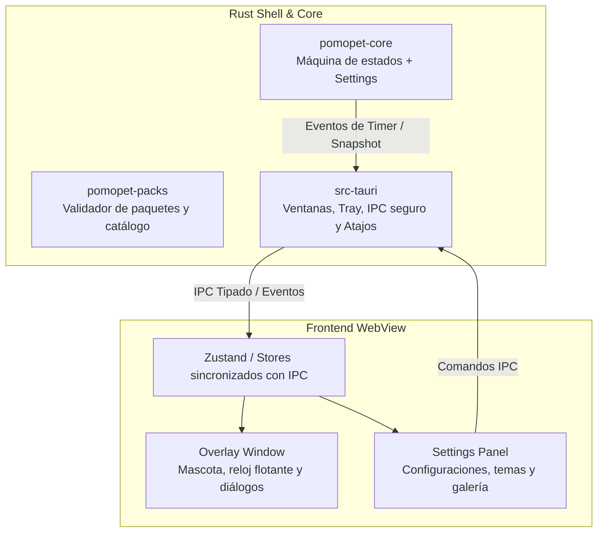

<div align="center">

# ⏱️ PomoPet 🐾

**Temporizador Pomodoro flotante y minimalista para Windows con mascotas interactivas y temas intercambiables.**

[](https://microsoft.com/windows)
[-FFC131?logo=tauri&logoColor=black)](https://tauri.app)
[](https://react.dev)
[](LICENSE)
[-brightgreen)](#privacidad-y-seguridad)

</div>

---

## 🎯 Descripción y Objetivo del Proyecto

**PomoPet** nace con un objetivo claro: **proporcionar un temporizador Pomodoro que no estorbe y dé gusto tener a la vista**.

La mayoría de los temporizadores de escritorio se esconden en pestañas del navegador, ocupan espacio innecesario en pantalla o demandan atención constante. PomoPet vive como una **ventana flotante transparente y compacta (overlay)** sobre cualquier programa (tu IDE, navegador, suite ofimática o juego en ventana).

El estado de tu sesión de trabajo se refleja directamente en tu mascota:
- Durante la fase de **enfoque**, tu compañero trabaja o descansa pacíficamente a tu lado.
- Al llegar a **cero**, la mascota despierta o celebra, alertándote visual y sonoramente de que es momento de estirar las piernas y tomar agua.

---

## ✨ Características Principales

### 🪟 Overlay Flotante Transparente
- **Siempre visible**: Flota sobre tus ventanas sin robar el foco de tu trabajo.
- **Transparencia real**: Sin marcos molestos ni fondos opacos; se integra de forma limpia con tu escritorio.
- **Personalización dimensional**: Ajuste suave de escala (50% al 200%) y opacidad (30% al 100%).
- **Arrastrable y reubicable**: Colócalo donde prefieras o restablécelo a la esquina inferior derecha con un clic.

### 🐾 Mascotas de Acompañamiento
- **Mielcita**: Tierna perrita chihuahua con animaciones fluidas, reacciones a caricias, partículas y reloj con marco gráfico temático exclusivo.
- **Gato Clásico**: Felino que duerme plácidamente mientras trabajas y despierta con la alarma.
- **Nano Panda**: Acompañante relajado con estética pixel-art.
- **Interacción y Bienestar**: Haz clic sobre tu mascota para darle un cariñito y recibir frases de ánimo y consejos de postura/hidratación mediante bocadillos de diálogo contextuales.

### ⏱️ Estilos de Reloj Nativos y Temáticos
Elige la presentación que mejor se adapte a tu estilo de trabajo:
- ⏱ **Clásico (Digital)**: Pastilla elegante con tiempo prominente y controles táctiles.
- ⭕ **Anillo (Circular)**: Indicador concéntrico de progreso con contador central.
- ━ **Barra Compacta**: Barra horizontal estilizada con avance continuo.
- · **Minimalista**: Tipografía ultradiscreta con punto de estado para mínima distracción.
- 🐾 **Reloj Exclusivo de Mielcita**: Marco temático con barra de progreso integrada.

### 🖱️ Modo Click-Through (Atravesar Clics)
¿Necesitas interactuar con botones o texto situados justo debajo del overlay? Activa el modo **Click-Through**: los clics del ratón atravesarán la mascota y el reloj hacia tus programas sin interferir. Puedes activarlo y desactivarlo al instante desde la bandeja del sistema (*System Tray*).

### ⚙️ Panel de Ajustes Completo
- **Fases personalizables**: Minutos de enfoque, descansos cortos, descansos largos y número de ciclos.
- **Automatización**: Opción de inicio automático de descansos y de nuevos bloques de foco.
- **Sonido y Alertas**: Chime armónico generado mediante Web Audio API con volumen graduable y duración de alarma configurable.
- **Accesibilidad**: Soporte nativo para modo de movimiento reducido (*reduced motion*).
- **Multilingüe**: Interfaz completamente disponible en **Español** e **Inglés**, con detección automática del sistema.
- **Arranque con Windows**: Inicia PomoPet discretamente junto con tu equipo.

### 📦 Sistema de Packs (Seguridad por Diseño)
- Instala nuevas mascotas y temas arrastrando archivos o carpetas sin necesidad de reiniciar la app.
- **Los packs son únicamente datos (Data, never code)**: compuestos exclusivamente por manifiestos JSON, spritesheets PNG/WebP y audio. Cero JavaScript, cero WebViews externas y cero riesgo de ejecución de código arbitrario.

---

## 🔒 Privacidad y Rendimiento

| Pilar | Compromiso |
|---|---|
| **Cero Telemetría** | No recopilamos analíticas, métricas ni identificadores de uso. |
| **100% Offline** | Todo funciona de manera local en tu máquina sin requerir conexión a internet. |
| **Sin Cuentas** | Sin registros, inicios de sesión ni planes de suscripción. |
| **Consumo Mínimo** | Desarrollado sobre el runtime ligero de Tauri 2 y WebView2 del sistema; uso insignificante de CPU y bajo consumo de memoria RAM. |
| **Precisión Absoluta** | El núcleo en Rust calcula el tiempo mediante marcas de tiempo absolutas (`ends_at`), garantizando coherencia incluso si suspendes tu laptop. |

---

## 🏗️ Arquitectura Técnica



- **Shell**: [Tauri 2](https://tauri.app) (Rust) interactuando con WebView2 nativo de Windows.
- **Núcleo de Temporizador**: Crate independiente `pomopet-core` (sin dependencias de GUI, 100% testeable en Rust).
- **Frontend**: [React 19](https://react.dev) + [TypeScript](https://www.typescriptlang.org) + [Vite](https://vitejs.dev), multipágina (`overlay.html` y `panel.html`).
- **Pruebas y Verificación**: [Vitest](https://vitest.dev) en frontend y `cargo test` + `clippy` en Rust.

---

## 🚀 Requisitos de Desarrollo y Compilación

Para compilar el proyecto en tu entorno local necesitas:

1. **Sistema Operativo**: Windows 10 (22H2+) o Windows 11.
2. **Rust**: Toolchain estable MSVC (`rustup default stable-x86_64-pc-windows-msvc`).
3. **Visual Studio C++ Build Tools**: Con la carga de trabajo de compilación en C++.
4. **Node.js**: Versión 20+ LTS (recomendada 22 o 24).
5. **pnpm**: Gestor de paquetes (`npm install -g pnpm`).
6. **WebView2 Runtime**: Incluido de fábrica en Windows 11 y versiones modernas de Windows 10.

---

## 🛠️ Comandos de Desarrollo

```powershell
# 1. Instalar dependencias
pnpm install

# 2. Iniciar en modo de desarrollo (inicia Vite y el shell de Tauri)
pnpm tauri dev

# 3. Compilar instaladores de producción (.msi / .exe vía NSIS)
pnpm tauri build

# 4. Ejecutar suites de pruebas
cargo test --workspace       # Pruebas unitarias de Rust
pnpm test                    # Pruebas unitarias frontend con Vitest

# 5. Análisis estático y formateo de código
pnpm typecheck               # Verificación de tipos TypeScript
pnpm lint                    # Linter ESLint
cargo clippy --workspace --all-targets -- -D warnings
cargo fmt --all -- --check
```

---

## 📂 Estructura del Repositorio

```
pomopet/
├─ Cargo.toml                  # Workspace Rust
├─ package.json, vite.config.ts# Configuración de frontend multipágina
├─ overlay.html, panel.html    # Puntos de entrada HTML de las ventanas
├─ src/                        # Código fuente del frontend
│  ├─ windows/                 # Ventanas independientes (overlay, panel)
│  └─ lib/                     # IPC client, render de mascotas, temas, stores, i18n
├─ src-tauri/                  # Shell Tauri: gestión de ventanas, bandeja del sistema, comandos IPC
├─ crates/
│  ├─ pomopet-core/            # Núcleo de cálculo Pomodoro y persistencia de ajustes
│  └─ pomopet-packs/           # Instalación y validación segura de packs
├─ packs/                      # Contenido empaquetado de fábrica (mascotas y temas)
├─ docs/                       # Especificaciones de arquitectura, contratos IPC y roadmap
└─ .github/                    # Flujos de trabajo de CI/CD para GitHub Actions
```

---

## 📄 Licencia

Este proyecto está bajo la licencia **MIT** para el código fuente.  
Los recursos gráficos de las mascotas se distribuyen bajo sus respectivas licencias de atribución de autor (como **CC-BY-4.0**), especificadas en el archivo `LICENSE` dentro de la carpeta de cada mascota en `packs/pets/`.
